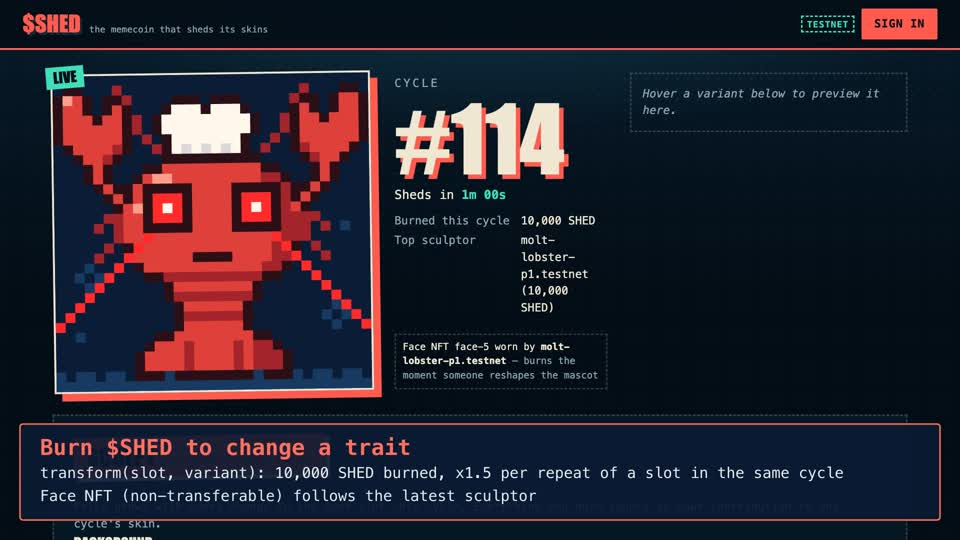

# SHED — the memecoin that sheds its skins

NEAR HACKATHON 2026 · track **Memecoins With Mechanics** (`memecoins`).

$SHED is a NEP-141 memecoin with a public mascot: a 32×32 pixel-art lobster. Holders **burn $SHED to change one of
its traits**. Every change mints the sculptor the live *face* NFT and burns the previous holder's face, whose
carapace is kept forever in a second collection, the **Exuviae**. At the end of each cycle, the mascot **sheds**: its
final look becomes a unique NFT (a *skin*) whose image is drawn by the contract itself. The skin is **auctioned in
$SHED**. Half of the winning bid is burned and the other half goes to the holders who sculpted that cycle, in
proportion to what they burned.

The mechanic runs in two contracts and nothing else: no backend, no admin key, no setter. Every parameter is fixed
at launch and readable through `config()`.

**Try it in the browser: <https://shedcoin.vercel.app>** (NEAR testnet, sign in with any testnet wallet).
Contracts: token + skins `shedcoin.testnet`, burn collection `exuviae.shedcoin.testnet` (10-minute cycles). **Both
accounts are locked**: every access key was deleted on 2026-11-13, so nobody can redeploy or change them. Check it:
`near account list-keys shedcoin.testnet network-config testnet now` returns an empty list.
Repository: <https://github.com/STOOOKEEE/shed>.

[](docs/media/shed-demo.mp4)

**Demo video (76 s):** [`docs/media/shed-demo.mp4`](docs/media/shed-demo.mp4), recorded on the live testnet
deployment: three transforms, a shed, a bidding war, the bot's post, the exuviae. **Bot:**
[@LobsterShed](https://x.com/LobsterShed) announces every look and auction result, reading the chain only.

<p>
 
 
 
 
</p>

Every image above is the contract's own output (`cargo run --example gallery`). The art is hand-placed pixel
sprites, one text file per trait in [`contract/art/src/sprites/`](contract/art/src/sprites); the contracts
stack the layers and emit an SVG, so the art never depends on a server or IPFS. 8 backgrounds × 8 shells ×
6 patterns × 6 faces × 5 claws × 7 headgear = 80,640 looks.

## The problem

Most memecoins have nothing to do: the joke lives on a chart and the "community" can only buy or sell. SHED gives
the community one onchain ritual with consequences:

- the supply only goes down, and how fast depends on what the community does;
- the shared mascot carries the history of every fight over its look;
- every cycle leaves a collectible, and its sale pays back the people who shaped it.

## The rule

1. **Fixed supply.** 1,000,000,000 SHED are minted once at launch. Nothing mints afterwards.
2. **Sculpt.** During a cycle, `transform(slot, variant)` burns the slot's current price from the caller and
   changes that trait. There are 6 slots (`background`, `shell`, `pattern`, `eyes`, `claws`, `headgear`) with a
   fixed list of variants each: no uploads, no free text, so nothing to moderate. The caller also attaches the NEAR
   storage their change creates (`transform_deposit` view): about 0.074 NEAR for the first change of a cycle,
   which pays for the future skin, about 0.004 NEAR for a new sculptor of the cycle, and 1 yocto after that.
3. **Last word costs more.** The price of a slot is `base × 1.5^k`, where `k` is the number of times that slot has
   already changed in the cycle. A tug-of-war over the shell gets expensive fast, and every step burns.
3b. **Wear the face, keep the exuvia.** Every change mints the *face* NFT (`face-n`) of the new look to the sculptor
   and burns the previous face in the same transaction. Only one face exists at a time: it belongs to whoever
   changed the mascot last. It cannot be transferred or approved: it is a title, not an asset, and its image is
   always the live mascot. The dethroned holder is not left empty-handed: the main contract mints them an
   **exuvia** in the burn collection (`exuviae.<contract>`), a permanent, tradable NFT of the look they wore, with
   how long they wore it and who dethroned them. The newcomer prepays its storage (≈0.014 NEAR, in
   `transform_deposit`). Fighting over the mascot now leaves a collectible on both sides.
4. **Shed.** Cycles run on a fixed schedule. When one ends, its final look is frozen into skin #n (NEP-171, SVG in
   the metadata) and the mascot carries that look into the next cycle. A cycle with no transformation makes no skin.
5. **Auction.** Each skin is auctioned in $SHED for one cycle. Bids are escrowed by the contract and outbid tokens
   are refunded immediately. A bid in the last quarter of the auction pushes the end back.
6. **Settlement.** 50 % of the winning bid is burned. The rest is claimable by that cycle's sculptors, pro-rata to
   what they burned (`claim_sculptor_share`). With no bid, the cycle's top sculptor gets the skin.
7. **No keeper.** Every mechanic call (`transform`, `bid`, `claim_*`, `shed`) first catches up on time: it settles
   finished auctions and closes finished cycles. `shed()` does only that and anyone can call it.

Full specification and JSON API: [docs/design.md](docs/design.md).

## Try it

### A. Local sandbox, read-only UI (no wallet, about 5 minutes)

Requirements: Rust (the toolchain in `contract/rust-toolchain.toml` is installed automatically), `cargo-near`
(`curl --proto '=https' --tlsv1.2 -LsSf https://github.com/near/cargo-near/releases/latest/download/cargo-near-installer.sh | sh`),
Node 20+.

1. `cd contract && cargo run --example local_demo`
   → you see a sandbox start, the contract deploy, 3 accounts claim the airdrop and sculpt, skin #1 go to
   auction with 2 bids, and a 3-change fight over the shell. The last line prints the command for the next step.
2. In a second terminal: `cd web && npm install && VITE_CONTRACT_ID=shed.sandbox VITE_NODE_URL=<printed url> npm run dev`,
   then open http://localhost:5173.
   → you see the live mascot (Sunset background, Ocean Blue shell, Chef Hat…), cycle #2 with the shell at
   33,750 SHED after 3 changes (10,000 × 1.5³), skin #1 on auction with a 30,000 SHED bid from `alice.sandbox`,
   107,500 SHED burned by sculpting, and the journal of every burn and bid.
3. Hover any variant in **Sculpt**.
   → the preview next to the mascot comes from the contract's `preview_svg` view.
4. Wait for the countdown (10-minute cycles). → **Shed pending** appears. The sandbox is read-only from the
   browser; the end-to-end test below exercises the shed and settlement transactions.

### B. Contract tests

1. `cd contract && cargo test` (after `cd contract/exuviae && cargo near build non-reproducible-wasm --no-abi` and
   `cd contract && cargo near build non-reproducible-wasm --no-abi`, which build the two wasm the sandbox deploys)
   → 97 unit tests: pricing, schedule, sprite sheets and rendering (every shape combination within the size
   budget), config validation, journal, every contract rule (burns, price growth, faces minted and burned, exuvia
   prepayment, shed, auction, anti-snipe, settlement, pro-rata claims), storage budgets measured against the worst
   case (largest SVG, 64-character accounts), and guards (contract account, unregistering bidders, raising one's own
   bid). Then `full_shed_cycle_on_sandbox` deploys **both contracts** on a real sandbox: airdrop → 3 transforms
   (faces minted and burned, transfer of a face rejected, **exuvia #1 minted to the dethroned sculptor** in the burn
   collection) → shed → 2 bids with refund → settlement burn → sculptor claim, checking `ft_total_supply`.
2. `scripts/smoke_testnet.py <contract> <player1> <player2>` plays the same round on **testnet** with real
   accounts (it passed on `shed-test.testnet`, 3-minute cycles).
3. `cargo run --example simulate`
   → the 60-cycle supply simulation used to choose the parameters ([docs/simulation.md](docs/simulation.md)).

### C. Testnet (hosted)

Open <https://shedcoin.vercel.app> (mirror built on every push by
[`.github/workflows/pages.yml`](.github/workflows/pages.yml): <https://stoookeee.github.io/shed/>), or run it locally
with `cd web && VITE_CONTRACT_ID=shedcoin.testnet npm run dev`. Sign in with a testnet wallet:

1. **Claim airdrop** → one transaction registers storage and claims 100,000 SHED (≈0.005 NEAR of storage).
2. **Sculpt**: pick a variant and confirm → your balance drops by the slot price, the supply panel shows the burn,
   and the next change of that slot costs ×1.5. If you are first in the cycle, the wallet asks ≈0.074 NEAR: the
   storage of the skin your cycle will become.
3. Change a trait someone else set last → the wallet also prepays their exuvia; the hero shows **you wear the face**
   and their exuvia appears in the **Exuviae** panel.
4. After the cycle ends, **Trigger shed** → skin #n shows up in **Auctions** and in the gallery.
5. **Bid** → your tokens are escrowed and the previous bidder is refunded.
6. After the auction, **Trigger shed** again → the skin moves to the winner, 50 % of the bid is burned, and the
   sculptors see **Claim share** in the gallery.

To deploy your own copy: [`scripts/deploy-testnet.sh`](scripts/deploy-testnet.sh) deploys the main contract and the
Exuviae sub-account in one go; [`scripts/lock-contract.sh`](scripts/lock-contract.sh) then deletes every access key on
both accounts.

## Parameters (fixed at launch)

| parameter | testnet demo | intended mainnet |
|---|---|---|
| total supply | 1,000,000,000 SHED | same |
| cycle / auction duration | 10 min / 10 min | 24 h / 24 h |
| anti-snipe window | 2.5 min | 6 h |
| base transform price | 10,000 SHED | same |
| price growth per change of a slot | ×1.5 | same |
| minimum bid / increment | 5,000 SHED / +5 % | same |
| share of winning bid burned | 50 % | same |
| airdrop | 100,000 SHED per account, 100M pool | 0 (disabled) |

The base price was chosen from the [simulation](docs/simulation.md): a steady community of 25 sculptors a day
burns about 12 % of supply in 60 days, a quiet one under 1 %. Because each slot's price climbs ×1.5 per change,
hype saturates instead of draining the supply. Only deliberate whale fights burn a lot, and the whales pay for it.

## Why NEAR

- **One contract is both NEP-141 and NEP-171.** Bids, refunds, burns and skin transfers are internal state
  changes: no callback, no reentrancy surface. The sandbox test shows the whole cycle settling inside single
  transactions.
- **Sub-accounts prove provenance.** Only the owner of `shedcoin.testnet` could create `exuviae.shedcoin.testnet`,
  so anyone can check the burn collection belongs to the project. It accepts mints from the main contract only, as
  a fire-and-forget cross-contract call: if it ever failed, the game itself would not be affected.
- **Onchain art is affordable.** NEAR's storage staking (about 1 NEAR per 100 kB) lets each skin keep its own
  pixel-art SVG (at most 4 kB, tested over every shape combination, base64 in NEP-177 `media`). The whole skin fits
  a 7 kB budget, 0.07 NEAR prepaid by the cycle's first sculptor. It does not depend on IPFS or a server.
- **Access keys make "no admin" checkable.** After `lock-contract.sh`, `near account list-keys <contract>` returns
  no key: nobody can redeploy or change parameters. Even before locking, the contract account cannot sculpt, bid
  or unregister (explicit guards), so it cannot tamper with the game it hosts.
- **Attached deposits are wallet confirmations.** `transform` (storage prepayment, at least 1 yocto) and `bid`
  (1 yocto) cannot be called with a function-call access key, the same guard as `ft_transfer`.

## Limits and abuse (read before judging)

- **Sybil.** Sculptor shares are linear in tokens burned, so splitting into many accounts earns nothing extra.
  Slot prices are per slot, so alts cannot sculpt cheaper. The **airdrop is trivially sybil-able**: it exists for
  the testnet demo and would be disabled (`airdrop_pool = 0`) on mainnet.
- **Whales** can dominate a cycle's look. That is the game: the last word is the most expensive, and it burns.
- **Self-bidding.** A sculptor can bid on their own skin; half of the bid still burns. Raising your own highest bid
  only escrows the difference.
- **Sniping** is limited by the anti-snipe extension, not eliminated.
- **Storage.** Callers prepay what they create: skins (by the cycle's first sculptor), contributions (by each new
  sculptor), exuviae (by whoever dethrones the face holder), airdrop records (by the claimer), FT registration
  (NEP-145). Budgets are upper bounds checked by unit tests. The contract's own balance only covers the bounded
  journal (64 entries) and must keep a small NEAR reserve; anyone can top it up with a plain transfer.
- **Exuviae inflation.** Every reshaping mints one exuvia, so they are not rare by count; their value comes from the
  look, the reign length written in the metadata, and the ×1.5 price ladder that makes each one cost a real burn.
- **Rounding.** Sculptor shares round down; dust stays in the contract.
- **Refunds always land.** Highest bidders cannot `storage_unregister` while their bid is escrowed, so an outbid
  refund can never be blocked by its recipient.
- **Deploy-to-lock window.** Between deployment and `lock-contract.sh`, the deployer key could still redeploy code.
  Run the two scripts back to back and check `list-keys` before trusting a deployment.
- **No price promise.** Burning reduces supply; it says nothing about the price.
- **Public RPCs rate-limit.** The web app reads through four public testnet endpoints and fails over to the next
  one on an error such as HTTP 429; a background tab stops polling.

## Repository

```
contract/            main contract (near-sdk 5.29, near-contract-standards)
  src/lib.rs         state, init, time advance
  src/sculpt.rs      transform + closing a cycle into a skin
  src/face.rs        face NFT: mint, burn, exuvia mint call
  src/auction.rs     bids, settlement, sculptor claims
  src/airdrop.rs     demo airdrop
  src/token.rs       NEP-141/145/148 + burn/escrow/payout helpers
  src/skins.rs       NEP-171/177/178/181 + skin minting + NFT burn
  src/views.rs       read-only API
  src/pricing.rs     price ladder, bid step, auction split, pro-rata (256-bit)
  src/schedule.rs    cycle schedule
  src/storage.rs     storage budgets and deposits
  src/journal.rs     bounded onchain log + NEP-297 events
  src/tests/         unit tests
  tests/             sandbox end-to-end test of both contracts (+ shared helpers)
  examples/          local_demo, simulate, gallery
  art/               shared pixel-art renderer: sprites/*.txt (one sheet per trait), palette, layers → SVG
  exuviae/           burn collection contract (mint by the main contract only)
web/                 Vite + TypeScript front end (@hot-labs/near-connect, near-api-js)
bot/                 optional X announcer (read-only on NEAR, posts new looks and auction results)
scripts/             testnet deploy, lock, smoke test
docs/                design, simulation, gallery, devlog
```

## Built with

near-sdk-rs 5.29, near-contract-standards 5.29, `uint` (256-bit math), cargo-near, near-sandbox, near-api-rs,
Vite, TypeScript, @hot-labs/near-connect, near-api-js. Written with AI coding assistance (Claude). Built from
scratch during NEAR HACKATHON (November 2026); no code predates the hackathon window.

## License

MIT, see [LICENSE](LICENSE).
