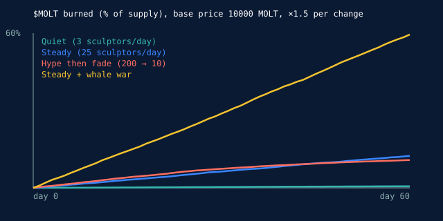

# Supply simulation (60 daily cycles)

Reproduce: `cd contract && cargo run --example simulate` (deterministic, fixed seed). The model uses the
contract's own `pricing::slot_price` and `pricing::split_winning_bid`.

## Model

- Total supply 1,000,000,000 SHED, price growth ×1.5 per change of the same slot in a cycle, 50 % of each
  winning bid burned.
- Each active sculptor tries `transforms_per_sculptor` changes on random slots and skips a change when the
  price exceeds what they are willing to pay: `base × 2..16` (log-uniform).
- The skin sells for 20–150 % of what the cycle burned. With fewer than 3 sculptors, no bid half of the time.
- "Whale war": on top of the steady community, two whales fight over one slot every cycle until a change
  costs 200 × base.
- Limits: wallet balances are not modelled (nobody runs out of tokens), nor price feedback, nor the
  sculptor pool being re-spent.

## Results

Burned after 60 cycles, by base price:

| Scenario | base 1,000 SHED | base 10,000 SHED | base 100,000 SHED |
|---|---|---|---|
| Quiet (3 sculptors/day) | 0.06 % | 0.63 % | 6.26 % |
| Steady (25 sculptors/day) | 1.24 % | 12.37 % | 100.00 % |
| Hype then fade (200 → 10) | 1.08 % | 10.79 % | 100.00 % |
| Steady + whale war | 5.95 % | 59.47 % | 100.00 % |

Chosen base price 10,000 SHED, burned by day:

| Scenario | day 7 | day 14 | day 30 | day 60 |
|---|---|---|---|---|
| Quiet (3 sculptors/day) | 0.07 % | 0.15 % | 0.33 % | 0.63 % |
| Steady (25 sculptors/day) | 1.39 % | 2.86 % | 6.33 % | 12.37 % |
| Hype then fade (200 → 10) | 1.84 % | 3.77 % | 7.41 % | 10.79 % |
| Steady + whale war | 6.76 % | 13.41 % | 28.82 % | 59.47 % |

## What we read from it

- **Hype saturates.** Eight times more sculptors on day 1 does not burn eight times more: each slot's price
  climbs ×1.5 per change, so a crowd quickly prices itself out of a slot. Burn per cycle is bounded by six
  price ladders, not by the crowd size.
- **Only deliberate fights burn a lot.** The whale-war line is the one that moves supply hard, and it is paid
  for by the two players who want the last word.
- **Chosen parameters:** base 10,000 SHED (0.001 % of supply). A steady community burns about 12 % in 60 days,
  a quiet one well under 1 %. 100,000 SHED would empty the supply under any real activity; 1,000 SHED
  makes the burn cosmetic.
